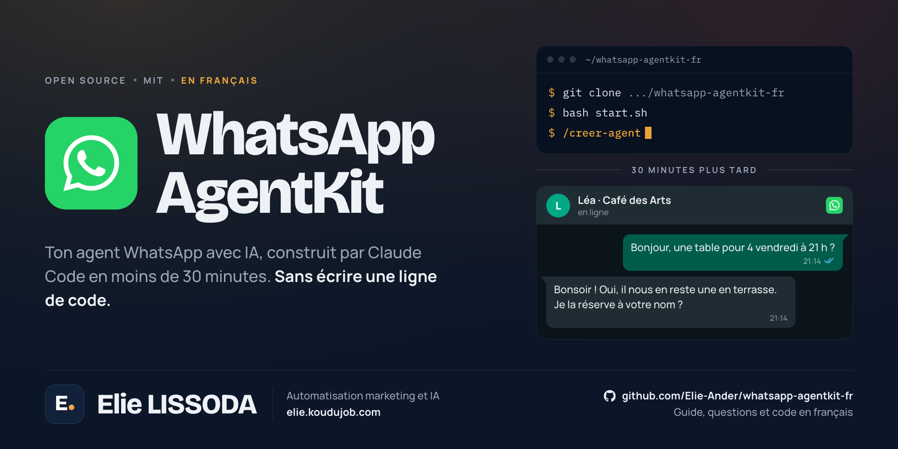

<p align="center">
  
</p>

<p align="center">
  <a href="LICENSE"></a>
  
  
  
  
</p>

<p align="center">
  <b><a href="https://elie-ander.github.io/whatsapp-agentkit-fr/">Voir le site</a></b> ·
  <a href="#démarrage-rapide">Démarrage rapide</a> ·
  <a href="#comment-ça-marche">Comment ça marche</a> ·
  <a href="#questions-fréquentes">Questions fréquentes</a>
</p>

---

## En bref

**WhatsApp AgentKit transforme une conversation de 20 minutes en un agent WhatsApp qui
répond à tes clients.**

Ce n'est pas un modèle à copier puis à adapter. C'est un jeu d'instructions que Claude Code
lit pour te poser des questions sur ton entreprise, puis écrire, tester et mettre en ligne
l'agent complet à ta place : le serveur, la connexion à WhatsApp, la mémoire de chaque
client et le prompt qui lui donne sa personnalité.

Tu n'écris pas de code. Tu réponds à des questions.

Dans un agent WhatsApp, 90 % du travail n'est pas l'IA. C'est la tuyauterie : webhooks,
signatures, jetons, nouveaux essais, mise en ligne. Cette partie est déjà réglée et
contrôlée ici. Il reste la seule chose que toi seul connais : comment fonctionne ton
entreprise.

Le kit est open source, sous licence MIT. Tout est en français, pour les indépendants et
les petites entreprises francophones.

---

## Démarrage rapide

```bash
git clone https://github.com/Elie-Ander/whatsapp-agentkit-fr.git
cd whatsapp-agentkit-fr
bash start.sh
```

Ouvre ensuite Claude Code et écris la commande :

```bash
claude
# dans Claude Code :
/creer-agent
```

C'est tout. Claude Code te guide à partir de là.

---

## Comment ça marche

`start.sh` ne fait que vérifier ton environnement. Le vrai départ, c'est `/creer-agent` :
Claude Code lit `CLAUDE.md` et déroule cinq phases.

### Phase 1 : il vérifie ton environnement

Il contrôle Python 3.11+, crée les dossiers, installe les dépendances et prépare le `.env`.

### Phase 2 : il te pose ses questions

Dix questions, une par une : le nom de ton entreprise, ce qu'elle fait, à quoi doit servir
l'agent, comment il s'appelle, quel ton il adopte, tes horaires, tes fichiers de prix ou
ta carte, ta clé API Anthropic et le service qui te connecte à WhatsApp.

### Phase 3 : il construit l'agent

Avec tes réponses, il écrit tout ceci :

```
ton-projet/
├── agent/
│   ├── main.py              Serveur qui reçoit les messages WhatsApp
│   ├── brain.py             Connexion à Claude : le cerveau
│   ├── memory.py            Historique de chaque client + déduplication des événements
│   ├── tools.py             Outils propres à ton entreprise
│   └── providers/           Connexion à ton service WhatsApp
│       ├── base.py          Interface commune
│       ├── __init__.py      Choisit le fournisseur automatiquement
│       └── zernio.py        Adaptateur (ou meta.py)
│
├── config/
│   ├── business.yaml        Les données de ton entreprise
│   └── prompts.yaml         Le prompt qui définit la personnalité de l'agent
│
├── knowledge/               Tes fichiers : carte, prix, conditions, FAQ
├── tests/test_local.py      Simulateur de chat dans ton terminal
├── Dockerfile               Pour la production
├── docker-compose.yml
└── .env                     Tes clés API, jamais envoyées sur GitHub
```

### Phase 4 : tu le testes

Un chat dans ton terminal où **toi**, tu écris comme si tu étais un client :

```
Toi : Bonjour, quels sont vos horaires ?
Agent : Bonjour ! Nous sommes ouverts du lundi au vendredi, de 9 h à 18 h.
        Puis-je vous aider pour autre chose ?

Toi : Combien coûte le café allongé ?
Agent : Le café allongé est à 2,50 €.
        Je vous en mets un de côté ?
```

Si quelque chose ne te plaît pas, tu le dis à Claude Code et il corrige sur place.

### Phase 5 : tu le mets en ligne

Il te guide pour l'envoyer sur GitHub, le relier à Railway, renseigner les variables
d'environnement et configurer le webhook. À partir de là, toute personne qui t'écrit sur
WhatsApp parle à ton agent.

---

## Se connecter à WhatsApp

Tu choisis l'un des deux pendant la configuration.

| | **Zernio** | **Meta Cloud API en direct** |
|---|---|---|
| Ce que c'est | Il tourne sur la WhatsApp Cloud API de Meta et s'occupe de la connexion | L'API officielle de Meta, en te connectant toi-même |
| Application Facebook | Pas besoin | Oui, de type Business |
| App Review | Non | Oui |
| Vérification de l'entreprise | Tu la fais depuis l'Embedded Signup | Compte Facebook Business vérifié |
| Coût | 2 comptes connectés gratuits, sans carte bancaire. Dans les deux cas, les conversations se paient à Meta | Tu paies Meta directement, sans intermédiaire |
| Tester sans numéro à toi | Oui, numéro de test partagé : 50 messages par 24 h, gratuit | Oui, Meta fournit un numéro de test, mais il faut d'abord créer l'application |
| Pour qui | **Recommandé.** Presque tout le monde | Si ton application Meta est déjà en place |

**Zernio** ([zernio.com](https://zernio.com)) est le chemin court : tu crées le compte, tu
connectes ton WhatsApp Business depuis le tableau de bord, tu copies la clé API et c'est
fait. Si tu n'as pas encore de numéro WhatsApp Business, son bac à sable te montre l'agent
en marche le jour même : tu réponds à un message depuis ton portable et tu es activé.

**Meta Cloud API** ([developers.facebook.com](https://developers.facebook.com)) te donne
le contrôle complet de l'intégration. La configuration de départ demande plus de travail.

Passer de l'un à l'autre plus tard tient en une phrase : ouvre Claude Code et dis-lui
*« je veux migrer de Zernio vers Meta Cloud API »*.

---

## Ce qui se passe quand un client écrit

```
Un client écrit « Bonjour » sur WhatsApp
         │
         ▼
Ton fournisseur (Zernio ou Meta) reçoit le message
         │
         ▼  webhook POST /webhook
main.py vérifie la signature du webhook
         │
         ▼
providers/ met le message dans un format commun
         │
         ▼
memory.py : cet événement a-t-il déjà été traité ? → si oui, on l'écarte
         │
         ▼
main.py répond 200 TOUT DE SUITE et met le travail en file d'attente
         │
         ▼  ──────── hors du cycle du webhook ────────
memory.py retrouve l'historique de CE client
         │
         ▼
brain.py appelle Claude avec le system prompt + l'historique + le message
         │
         ▼
providers/ envoie la réponse sur WhatsApp
         │
         ▼
Le client reçoit la réponse en quelques secondes
```

Trois choix de conception qui comptent :

**Répondre d'abord, travailler ensuite.** Les fournisseurs attendent une confirmation en
5 secondes environ et, s'ils ne la reçoivent pas, ils renvoient le même message jusqu'à
7 fois. Appeler Claude prend plus de temps que ça. Le webhook confirme donc tout de suite
et traite en arrière-plan. Sans ça, le client recevrait sept fois la même réponse.

**Dédupliquer par id d'événement.** La livraison est *at-least-once* (au moins une fois) :
le même message peut arriver deux fois. La base de données garantit une seule réponse.

**Vérifier la signature.** Chaque webhook arrive signé en HMAC-SHA256 et l'agent le
contrôle avant de toucher au message. Sans cette vérification, n'importe qui connaissant
ton URL pourrait injecter des messages dans ton agent. Attention : le contrôle a besoin de
`ZERNIO_WEBHOOK_SECRET` (ou de `META_APP_SECRET`). Si tu le laisses vide, l'agent démarre
quand même, pour que tu puisses tester sans rester bloqué, mais il le signale dans les
journaux et laisse tout passer. Renseigne-le avant de confier de vrais clients à l'agent.

**En plus :** chaque client a son propre historique. Si quelqu'un t'écrit aujourd'hui et
revient demain, l'agent se souvient de la conversation. Et il n'invente jamais une
information : s'il ne sait pas, il le dit et propose de passer le relais à une personne.

---

## Ce qu'il te faut

**1. Python 3.11 ou plus récent**
- Mac : `brew install python` ou [python.org](https://python.org/downloads)
- Windows : [python.org](https://python.org/downloads) (coche « Add to PATH »)
- Linux : `sudo apt install python3.11`
- Pour vérifier : `python3 --version`

**2. Claude Code**
```bash
# il te faut d'abord Node.js : https://nodejs.org
npm install -g @anthropic-ai/claude-code
claude   # la première fois seulement, pour te connecter
```

**3. Une clé API Anthropic**
[platform.anthropic.com](https://platform.anthropic.com/settings/keys) → Settings →
API Keys → Create Key. Elle commence par `sk-ant-...`.

**4. Un compte pour l'API WhatsApp**
[Zernio](https://zernio.com) (recommandé) ou
[Meta Cloud API](https://developers.facebook.com).

---

## Combien ça coûte

AgentKit est gratuit et open source. Ce que tu paies, c'est l'usage, et mieux vaut le voir
avec de vrais chiffres qu'avec un « c'est presque rien ». Les services ci-dessous
facturent en dollars, et leurs tarifs bougent : vérifie-les sur leur site avant de te lancer.

| Poste | Coût réel |
|---|---|
| AgentKit | Gratuit, MIT |
| Zernio | Les 2 premiers comptes connectés sont gratuits, sans carte bancaire. Si tu connectes ton propre numéro WhatsApp Business, le coût s'arrête là. Si tu demandes un numéro à Zernio, compte entre 3 $ et 21 $ par mois selon le pays |
| Meta Cloud API | Les conversations ouvertes par le client sont gratuites. Tu ne paies que celles que tu lances toi-même avec un modèle de message |
| API Claude | À l'usage. Voir le calcul plus bas |
| Railway | Il n'y a plus de vraie offre gratuite : tu démarres avec 5 $ de crédit d'essai, puis l'offre Hobby coûte 5 $ par mois |

### Choisir le modèle de Claude

Il se change avec la variable `ANTHROPIC_MODEL`, sans toucher au code.

| Modèle | ID | Prix par million de tokens | Quand l'utiliser |
|---|---|---|---|
| Claude Opus 5 | `claude-opus-5` | 5 $ en entrée / 25 $ en sortie | L'agent raisonne sur des catalogues, des agendas ou des règles complexes |
| **Claude Sonnet 5** | `claude-sonnet-5` | 3 $ / 15 $ | **Par défaut.** Le bon équilibre pour répondre à des clients |
| Claude Haiku 4.5 | `claude-haiku-4-5` | 1 $ / 5 $ | Seulement pour des questions fréquentes et des réponses courtes |

**Le calcul, sans arrangement.** Un chatbot ne se paie pas au message : il se paie au
token, et à chaque tour on renvoie à Claude le system prompt complet plus l'historique de
la conversation. C'est ce qui fait grimper le coût plus vite qu'on ne s'y attend.

Une conversation de 8 allers-retours, avec un system prompt d'environ 1 500 tokens (les
informations de ton entreprise), consomme à peu près 16 000 tokens en entrée et 1 200 en
sortie :

| Modèle | Par conversation | 300 par mois | 1 000 par mois |
|---|---|---|---|
| Claude Opus 5 | ~0,11 $ | ~33 $ | ~110 $ |
| Claude Sonnet 5 | ~0,07 $ | ~20 $ | ~66 $ |
| Claude Haiku 4.5 | ~0,02 $ | ~7 $ | ~22 $ |

Ce sont des estimations : si ton system prompt est plus long (une grande carte, un
catalogue entier), le coût monte en proportion. Le moyen le plus efficace de le baisser
n'est pas de changer de modèle, c'est de ne pas mettre dans le prompt des informations que
tes clients ne demandent jamais.

---

## Exemples d'usage

| Entreprise | Ce que fait l'agent | Exemple |
|---|---|---|
| **Restaurant** | Carte, horaires, adresse | « Le plat du jour est... » |
| **Cabinet / salon** | Prend les rendez-vous et les réservations | « Votre rendez-vous est noté mardi à 15 h » |
| **Agence immobilière** | Qualifie les prospects et envoie les informations | « Nous avons 3 appartements dans votre budget... » |
| **Boutique en ligne** | Prend les commandes sur WhatsApp | « Votre commande de 2 gâteaux est confirmée » |
| **SaaS / logiciel** | Service après-vente | « Pour réinitialiser votre mot de passe, suivez ces étapes... » |
| **Toute entreprise** | Questions fréquentes, jour et nuit | « Nous sommes ouverts de... » |

**Ce qu'il fait et ce qu'il ne fait pas, pour éviter les surprises.** L'agent converse :
il comprend, il répond avec les informations de ton entreprise, il prend les coordonnées
et te les laisse dans l'historique. Ce qu'il ne fait pas encore tout seul, c'est
*exécuter* l'action de l'autre côté : écrire dans ton agenda, décompter un stock,
encaisser. `agent/tools.py` est prévu pour cette partie, avec des fonctions prêtes à
brancher. Le demander à Claude Code est l'étape suivante, pas quelque chose qui marche
dès l'installation.

---

## Commandes utiles

```bash
# Tester l'agent sans WhatsApp (chat dans le terminal)
python tests/test_local.py

# Démarrer le serveur en local
uvicorn agent.main:app --reload --port 8000

# Construire avec Docker pour la production
docker compose up --build

# Voir les journaux de l'agent
docker compose logs -f agent

# Auditer ce dépôt (les 6 contrôles du kit)
python3 scripts/audit.py
```

---

## Le personnaliser ensuite

Pas besoin de toucher au code. Ouvre Claude Code et demande tes changements en français :

```bash
claude "L'agent est trop formel. Rends-le plus amical et décontracté."
claude "On propose maintenant la livraison. Mets l'agent à jour."
claude "Je veux qu'il puisse consulter les créneaux de rendez-vous disponibles."
claude "Je veux migrer de Zernio vers Meta Cloud API."
```

---

## Stack technique

| Composant | Technologie | À quoi ça sert |
|---|---|---|
| IA | Claude (`claude-sonnet-5` par défaut) | Génère les réponses |
| Serveur | FastAPI + Uvicorn | Reçoit les webhooks de WhatsApp |
| WhatsApp | Zernio / Meta Cloud API | Relie l'agent à WhatsApp, au choix |
| Base de données | SQLite en local / PostgreSQL en production | Historique et déduplication |
| Mise en ligne | Docker + Railway | Met ton agent sur internet |
| Configuration | python-dotenv + YAML | Clés API et réglages |

Le kit utilise un **patron adaptateur** pour les fournisseurs : chacun implémente la même
interface, donc `main.py` ne sait pas, et n'a pas besoin de savoir, lequel tu utilises. Il
appelle seulement `fournisseur.verifier_signature()`, `fournisseur.analyser_webhook()` et
`fournisseur.envoyer_message()`.

---

## Ce que ce kit apporte

- **Tout est en français** : le guide, les dix questions, le code généré, ses commentaires
  et ses noms de variables.
- **L'agent parle à tes clients en français**, et les vouvoie par défaut.
- **Les exemples sont adaptés** : euros, horaires à la française, numéros en +33.
- **Un point sur le RGPD** au moment de la mise en production, parce que l'agent garde les
  conversations de tes clients.
- **Ta clé API reste à toi** : le guide te propose de la coller toi-même dans le `.env`
  si tu préfères ne pas l'écrire dans la conversation.
- **La commande s'appelle `/creer-agent`**.

**Ce qui a été vérifié.** L'audit du kit passe : les neuf fichiers de code du guide
compilent, le YAML se lit, les variables d'environnement sont toutes documentées. L'agent
généré a ensuite été essayé de bout en bout avec les deux fournisseurs, sans réseau, avec
un faux Claude et un faux WhatsApp : signature, doublons, mémoire, panne de Claude.

---

## Questions fréquentes

**Faut-il savoir programmer ?**
Non. Claude Code écrit tout le code. Toi, tu réponds à des questions sur ton entreprise.

**Puis-je m'en servir pour ma vraie entreprise ?**
Oui. Après l'avoir testé en local, tu l'envoies sur Railway et il répond pour de vrai.

**Et si l'agent ne sait pas quelque chose ?**
Il répond quelque chose comme *« Je n'ai pas cette information, je vous mets en relation
avec une personne de l'équipe. »* Il n'invente jamais.

**Puis-je avoir plusieurs agents ?**
Oui. Clone le dépôt une fois par entreprise. Chaque agent est indépendant.

**Puis-je changer de fournisseur WhatsApp plus tard ?**
Oui. Ouvre Claude Code et dis-lui ce que tu veux changer. Il régénère les fichiers concernés.

**L'agent peut-il écrire en premier à un client ?**
Pas d'emblée, et ce n'est pas une limite d'AgentKit : WhatsApp n'autorise le texte libre
que dans les 24 heures qui suivent le dernier message du client. Au-delà, il faut un
modèle de message approuvé par Meta. Comme l'agent répond toujours à quelqu'un qui vient
d'écrire, ce n'est jamais un problème en pratique.

**Que deviennent mes données ?**
Tout tourne chez toi : ton serveur, ta base de données, tes clés API. AgentKit n'a ni
serveur à lui ni télémétrie. En revanche, les messages passent par ton fournisseur WhatsApp
et par l'API d'Anthropic, et ton agent garde les conversations de tes clients : le RGPD
te concerne. Le guide t'en parle au moment de la mise en production.

---

## Contribuer

Les issues et les pull requests sont les bienvenues. Avant d'ouvrir une PR, lance l'audit :

```bash
python3 scripts/audit.py
```

Il vérifie que le code des modèles compile, que le YAML se lit, que les variables
d'environnement sont documentées et que les liens du README répondent.

---

## Crédits

**Elie LISSODA** · [elie.koudujob.com](https://elie.koudujob.com)

Basé sur un kit open source publié sous licence MIT. Les mentions d'origine sont dans le
fichier [LICENSE](LICENSE).

Construit avec [Claude Code](https://claude.com/claude-code).

Un souci pour l'installer, ou une question ? Je suis disponible sur
[elie.koudujob.com](https://elie.koudujob.com) 😉

---

## Licence

MIT. Utilise ce projet comme tu veux, pour ce que tu veux.
